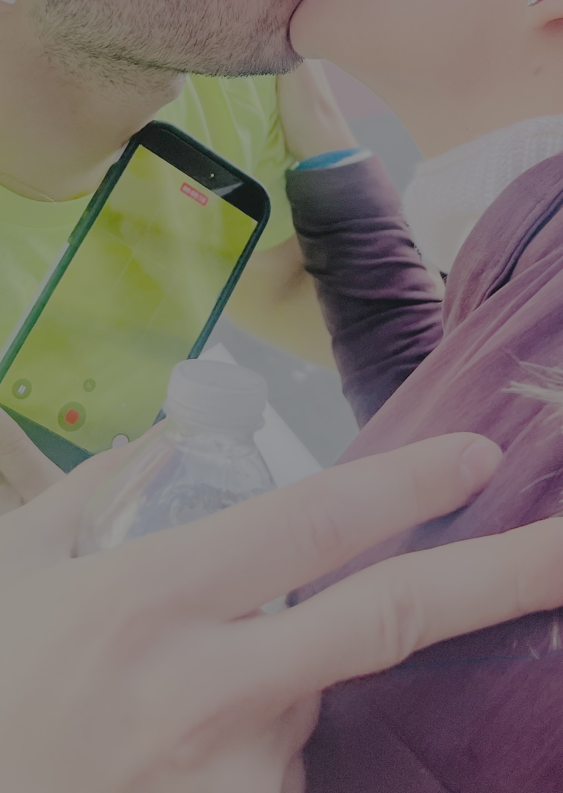

The experience of living in New York means that at some point, you will have to interact with the New York Marathon. You first hear of it, maybe, years before moving here. You might even randomly encounter, walking in Central Park in the weeks before, crews assembling huge parts of infrastructures. You can imagine the crowds and be a little bit scared by the massive mass of it all.

You hear of the famous semi sanctioned [bike race](https://www.reddit.com/r/NYCbike/comments/1g5fogg/new_york_marathon_cracks_down_on_cyclists_prerace/) that happened in the morning, that rare chance to be in streets typically closed, going full speed. If feet get freedom that day, why not rubber. But RIP, no more.

As a sign of your integration into polite NY society, you get invited to cheer for a friend of a friend, a cheer plus one. You are there happy for people happy-for-people-who-are-running and it still feels real, but it's far from your heart. You enjoy and keep being a little scared. The crowds are real. They are cheering, sweaty, and supremely real. Everything is real.

The true consecration, my "you've made it baby" sign, happens a few more years in still - you get an invitation to go see a friend, someone you know and care about, run. That, truly, feels epitomic. It's a high. All friendships are a high, but a marathon invite feels like a friendship PhD.

What am I trying to say - well. It happened. I went outside today, and everything was top shelf, top notch, the S-est of tiers, every-thing. Weather. Sunlight. Humidity. An early november wind. Uncrunched leaves. Even babies knew that crying was not *in* today. Humanity smiled at God, God smiled back, and runners were in peace. For multiple moments, I understood happiness.

The crowds were also agoraphobically huge. Despite everyone being a level of giddy that you'd wish more of (should there be more marathons), it all felt surprising and scary. But good scary, in a "this is a new experience that I hope never loses its edge".

But then, I opened the NYRR mobile app.

As Jon Stewart would say, "Motherfucker."

This was maybe my true-r consecration as a New Yorker (a person who complains??). The app tried - I suppose that it tried, maybe it didn't try, I can't be bothered to ask the app how it felt doing what it did - tried to show results, numbers, maps.

On the day of the marathon, you and I - technologists, maybe, if you are, if not, read on - would all expect a few things from the app, but not what the 2.4 average star review score was trying to prepare me for. Even the App Store AI app overview was diplomatically pointing out that this app failed people, and that this made people angry.

It's a special kind of anger - and I am being unfairly strident and singling out an app, one, one of b?illions - but that anger is deserved when, runners, running by, at a leisurely (for them) and beautifully brisk (for me) pace, zoom by you, and you have but seconds to grab their attention, hug&squeeze them, and let them go finish their miracle.

**The position of a runner on a map is the point of this garbage app.**

And the position of a runner - of a single runner I was doing my best to track - resulted in getting an incredible compendium of grotesque errors.

"Request failed with status code 504"

(no error, just a loading spinner that was also stuck)

"Request failed with status code 500"

"You're offline. Please check your connection."

How the fuck can you mess it up like this this bad like that.

On the single day of the marathon. A single, unique day.

A lot of things can exist for a day. CDNs (do you know what those are?), static serving, caches. Redundancy. Load balancing.

I cannot imagine the frustrating experience that anyone would feel working at a place that can consistently create things that are so broken that complaints pile up all saying the same thing: 

<div style="text-align: center; font-size: 24px;margin-top:10px;margin-bottom:20px; font-family: serif; font-style: italic">"I couldn't track the person I care for the most in the world."</div>

Yes, the literal "you had one job" is sometimes appropriate to scream at people.

But screaming won't fix this. Blog posting won't fix this. Marathoners will marathon and all that matters, for real and for real, is that everyone gets there safely. And (thank God!) many other people, who are the opposite of garbagely incompetent, will make sure that runners get hydrated, taken care of, supported, etc.

I am so goddamn tired of self-inflicted fragility.

---

Happy ending: my friend was running too fast to get a picture, and I was standing on the wrong side, and screaming anyone's name, if you're not doing it as a group of 10 or more, is senseless - you get lost in the noise. But truly, no regrets - it was nothing but beauty.

A minute or two before my friend appeared in the distance, I saw a runner run towards our side, and my neighbor excitedly getting her phone out. They embraced - and my neighbor's phone ended up being useless and unused - she was busy being happy, not taking pictures. God bless.

I got lucky and pressed on my shutter at that exact moment. I turned to her, apologized a little bit for the candid and unprompted photo, was told it was great and nothing to apologize for, and AirDrop'ed it to her. AirDrop has its faults, but it's not programmed by squirrels, so it actually worked.

---

NYRR, I'd be happy to consult with you for free because honestly, I can be a rude blogger but I mean extremely well. In the meantime, pass it on:

```bash
echo "make my backend not crash the day that people use it." >> CLAUDE.md
```

---

<div style="margin-top: 20px;font-size:12px; text-align: center;"><br/>
the picture, cropped.
</div>


